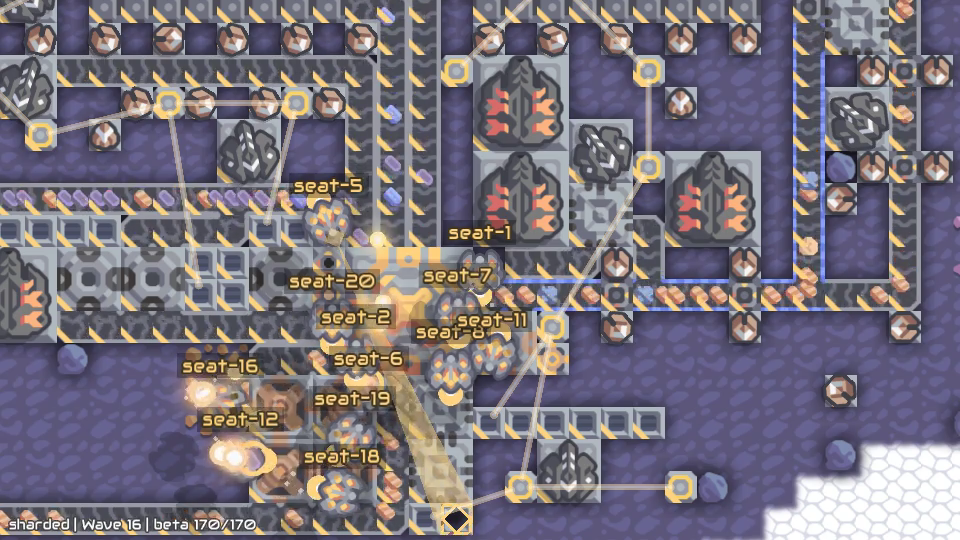

# Mindustry Endless Survival

A cooperative Harbor Multiagent task: 1–20 agents defend one core on Mindustry's Fork map against endless waves. Each agent has its own workspace and controls a player in the same native game. The team's score is how many minutes it survives.

Live seat cameras are off by default. The game server logs the whole game, and any
seat's view can be rebuilt from that log and watched afterwards, by you or by a
coding agent following [Recreating recordings from the game log](#recreating-recordings-from-the-game-log).

Built on [Mindustry](https://mindustrygame.github.io), created by Anuken and its contributors. See the [upstream game repository](https://github.com/Anuken/Mindustry).



*A 20-agent survival rollout at wave 16*

## Structure

```text
mindustry-endless-survival/
├── task.toml                 # Seats, verifier and collected artifacts
├── instruction.md            # Shared agent instructions and HTTP API examples
├── instructions/             # Per-seat instructions written by scripts/configure.py
├── config.json               # Version, seat count, briefing and game settings
├── scripts/                  # Configure the task, prepare instructions and preflight jobs
├── job.json                  # Two-seat Harbor job: harness, models and credentials
├── environment/
│   ├── Dockerfile            # Public dependencies and native runtime
│   ├── docker-compose.yaml   # Shared game, API gateway, agents and any live cameras
│   ├── plugin/               # Native game bridge, survival rules and replay capture
│   ├── sim/                  # API, lifecycle, evidence and deterministic grading
│   ├── task-runtime/         # Scenario contract, startup and collection
│   ├── renderer/             # Game client plugin for recording
│   ├── seat-client/          # Per-seat live camera and its recording
│   ├── render-recording/     # Render the game log into seat or fixed-camera videos
│   ├── gateway/              # Authenticated API proxy
│   ├── seat-box/             # Agent workspace image
│   └── dependencies/         # Screen recorder and dependency notices
├── tests/
│   └── test.sh               # Production verifier entrypoint
└── solution/
    ├── solve.sh              # Oracle sanity check, not a winning strategy
    └── tests/                # Regression tests and native fixtures
```

## How it works

Agents control the game through the HTTP API. The game server writes a log of everything it sends to all players, and `render-recording/` turns that log into a video of any seat after the run; see [Recreating recordings from the game log](#recreating-recordings-from-the-game-log). With live cameras on, `environment/renderer/`, a small plugin for the native Mindustry game client, follows each agent’s player so a camera container can film that seat during the game. The camera's game client joins the server directly at `main:6567` on the Compose network, and reports to the control server at `MINDUSTRY_CONTROL_URL` (`http://main:9001`). `seat-client/` manages those client processes and video files.

Agents join a readiness barrier, and the game waits for each live camera when cameras are on. Agents then use the HTTP API to inspect the world, move, build, mine and communicate. The game runs until the core is destroyed. If agents stop first, collection lets the native game finish before verification.

`instruction.md` is the only instruction source. `scripts/configure.py` writes
one `instructions/seat-N.md` per seat from it, which Harbor Multiagent loads.
The committed files match the default `config.json`. Rerun the script after
changing settings or `instruction.md`.

## Reward

The verifier validates native core-loss evidence and writes elapsed seconds divided by 60 to **`/logs/verifier/reward.json`**. For two seats surviving 12.5 minutes:

```json
{"reward": 12.5, "seat-1": 12.5, "seat-2": 12.5}
```

`reward` is the team outcome; each seat receives the same value. Do not sum these fields or treat seats as independent trials. Compare teams at the same roster size and settings. Scores are minutes, not normalized probabilities or binary success values.

For example, four seats of Codex with `openai/gpt-6-luna` at high reasoning effort, on the default settings and on Daytona, survived 26.8 minutes (11 waves) for $0.77 in model cost; the trial took 31 minutes end to end.

Missing or contradictory evidence is an invalid, unscored attempt. Stopping a game while its core is alive is censored, not a completed survival score. The verifier removes stale rewards before grading. Details go to `survival-outcome.json` and `metrics.json` beside the reward file.

The verifier writes Harbor's standard JSON format directly. No LLM judge or Rewardkit dependency is needed.

## Environment variables

| Variable | Required | Description |
|---|---|---|
| `OPENAI_API_KEY` | Yes, for the default job | OpenAI API key used by both Codex participants running Luna. Export it in the shell running Harbor. |

Other agents use their provider’s credentials. The game and verifier make no LLM calls. The task's Compose file sets each agent's `MINDUSTRY_SEAT` and `MINDUSTRY_SIM_URL`, and the task generates API tokens automatically; no game-service credentials are needed.

## Run

Requires Docker with Compose, Python 3.12+, Node.js 22 and [Harbor Multiagent](https://github.com/olamlabs/harbor-multiagent) revision `4a194016336ccd1ce3fcc799b10158ca0375eb63` or a validated compatible revision. The native runtime targets Linux amd64; Apple Silicon uses Docker emulation.

Install the pinned public runner with [uv](https://docs.astral.sh/uv/) 0.13.5 or newer:

```sh
uv tool install --python 3.12 "git+https://github.com/olamlabs/harbor-multiagent@4a194016336ccd1ce3fcc799b10158ca0375eb63"
```

This installs the `harbor` command. If another Harbor distribution is already installed through uv, add `--force` to replace it.

From the repository root:

```sh
cd mindustry-endless-survival
export OPENAI_API_KEY="your-openai-api-key"
harbor run -p . -c job.json
```

All commands below assume this task folder is your working directory. The default
job runs two Codex agents with `openai/gpt-6-luna` and high reasoning effort.
Harbor installs Codex in each agent container and configures API-key authentication.

Live seat cameras are off: `settings.video.record` is `false`, and the generator
adds no camera containers. The game log still records the game, so you can film
any seat afterwards. To film seats live as well, set `settings.video.record` to
`true` in `config.json` and rerun `python3 scripts/configure.py`. Then
`settings.video.seats` picks the seats: `"all"` (the default), a list such as
`["seat-1"]`, or a number of seats from `seat-1` up. Only those seats get a
camera container.

Results, logs and recordings are saved under `jobs/<timestamp>/`. To name a run,
add a top-level `job_name` to `job.json`. Use a fresh name for each new run;
Harbor resumes an existing job when its configuration matches.

`config.json` controls the game; `job.json` controls the run and its participants.
For each participant, `name` selects the harness and `model_name` selects the
model. Adapter options such as `reasoning_effort` belong in `kwargs`; provider
credential references belong in `env`. The default job sets
`disable_web_search: true` for every agent, which turns off the harness's web
search and fetch tools. Each seat can use a different supported
harness/model combination. Keep `${OPENAI_API_KEY}` in the job file and set the
actual key only in your shell.

Current Harbor Multiagent requires explicit participants for multi-seat tasks;
the single-agent `--agent` / `--model` flags do not fill these seats. The default
job has `n_attempts: 1`, so it launches one survival match.

### Other LLM providers

Provider support comes from the chosen Harbor agent adapter. For example, to use
[Claude Sonnet 4.6](https://platform.claude.com/docs/en/models/sonnet-4-6/overview)
through Claude Code and the direct Anthropic API, replace a participant in
`job.json` with:

```json
{
  "seat": "seat-1",
  "name": "claude-code",
  "model_name": "anthropic/claude-sonnet-4-6",
  "env": {
    "ANTHROPIC_API_KEY": "${ANTHROPIC_API_KEY}"
  },
  "kwargs": {
    "disable_web_search": true
  }
}
```

Keep each participant's existing seat ID. Apply this to every participant for an
all-Claude team, or change individual seats to mix providers. Replace the entire
participant entry so Codex-specific options and credentials are not carried over.
From this task folder:

```sh
export ANTHROPIC_API_KEY="your-anthropic-api-key"
harbor run -p . -c job.json
```

Only seats still using OpenAI need `OPENAI_API_KEY`. Other providers require an
adapter that supports their API and credentials; changing the model prefix alone
is not sufficient. See [Harbor Multiagent](https://github.com/olamlabs/harbor-multiagent)
for available adapters. This example has been checked against the pinned runner's
configuration and adapter; it is not a reported Claude evaluation of this task.

### Team and wave configuration

Use `config.json` to save game settings and `job.json` to choose each seat's
harness, model and credentials. The configuration flags below are shortcuts that
update `config.json`; they are not temporary overrides for `harbor run`.

Edit `config.json`, then run `python3 scripts/configure.py` to validate it and
regenerate Compose, the Harbor roster and seat instructions. The script does not
edit `job.json`: its participants must match `seat-1` through `seat-N` for the
configured seat count.

| Setting | How to set it | Default |
|---|---|---|
| Team size | `python3 scripts/configure.py --seats N`, with 1–20 seats; update the job's participants to match `seat-1` through `seat-N` | 2 seats |
| Team models | Set `model_name` for each participant in `job.json`; `name` selects that seat's harness | Codex with `openai/gpt-6-luna` and high reasoning effort for both seats |
| Wave schedule briefing | `--wave-schedule-briefing` reveals the schedule in agent instructions; `--no-wave-schedule-briefing` hides it | Off (`wave_schedule_briefing: false`) |

By default (`wave_schedule_briefing: false`), agents are not given the wave
schedule in their instructions. To opt in, run `python3 scripts/configure.py --wave-schedule-briefing`; to hide it
again, use `--no-wave-schedule-briefing`.

The default first wave arrives after **4 minutes** of native simulation time, then waves arrive **every 2 minutes**, regardless of whether earlier enemies have been cleared. `config.json` stores these as `settings.endless_survival.first_wave_ticks: 14400` and `wave_spacing_ticks: 7200` at 60 ticks per simulation second. The briefing flag changes only what agents are told, not wave timing or difficulty.

The match explicitly uses **Fork**, map and spawn seed **1**,
and enemy health/damage multipliers **1**. `settings.time_limit_sec`
is `null`: the match ends at core loss. Harbor separately permits 63,000 seconds
(17.5 hours) for each agent, collection and verifier phase. Those phase limits
are not a completed-survival horizon; a run cut short while the core is alive
remains unscored.

For four seats with the default hidden schedule, first update `job.json` to
contain `seat-1` through `seat-4`, each with a harness, model and credential
reference. Then prepare and launch the task:

```sh
python3 scripts/configure.py --seats 4 --no-wave-schedule-briefing
harbor run -p . -c job.json
```

To switch back to two seats with the schedule hidden, run
`python3 scripts/configure.py --seats 2 --no-wave-schedule-briefing` and restore
the two-participant job. Other settings remain unchanged. Configuration writes
persist in this checkout; rerunning the script does not reset defaults.

To build locally without launching a trial:

```sh
docker compose -f environment/docker-compose.yaml build
```

Builds use public dependencies and require internet access, with no private image or registry login. Run trials through Harbor so it mounts logs and invokes collection and verification. The default simulation requests 8 CPUs/8 GiB; each agent requests 2 CPUs/2 GiB, and each live camera container the same when cameras are on. Start with a small roster.

`environment/sim/metrics.mjs` summarizes native production, resource flow, stockpiles, combat and progression into `metrics.json` in the verifier and simulation logs. These diagnostics help explain a run; they do not add reward dimensions or change the shared survival score. Missing measurements are reported explicitly.

Only endless survival on Fork is supported; PvP, attack, sandbox and finite-duration games are rejected.

## Recreating recordings from the game log

Live seat cameras are off by default; this section is how you watch a seat. While the game runs, the server logs everything it sends to all players. After the trial, `environment/render-recording/render.mjs` plays that log back into a real Mindustry client and films it. You can film any seat, or a fixed spot on the map, for any time range. Nothing is played again: no agents, no game logic. The steps below are complete enough for a person or a coding agent to follow.

### What is recorded

With `settings.replay.record` set to `true` (the default), the server writes its network stream to `/logs/sim/replay/` in the `main` container. That is everything the server sends to all players: world data, unit, building and game-state snapshots, and the other server calls. Packets addressed to one player are not in it. Harbor collects `/logs/sim`, so after a trial the log is here:

```text
jobs/<job>/mindustry-endless-survival__<id>/artifacts/logs/sim/replay/
├── segment-000.mreplay   # the log, in order
├── segment-001.mreplay   # more segments on longer games
├── stats.json            # recorder summary and time marks
└── manifest.json         # size and SHA-256 of each segment; written only when the log closed cleanly
```

`<job>` is the job name, a timestamp unless `job.json` sets `job_name`. `<id>` is the random suffix Harbor gives each trial.

Each segment starts with `MREPLAY1`, a 4-byte big-endian length and a JSON header. The header names the format (`mindustry-replay/1`), the Mindustry build, the SHA-256 of the server JAR and the loaded mods. A gzip stream of records follows. A record is a packet, a keyframe or a mark, stamped with nanoseconds since the recorder started. A keyframe is a full copy of the world, the same data a joining player gets. The recorder writes one when the map loads and then every `keyframe_sec`. A new segment starts at the first keyframe after `segment_sec`.

| Setting in `config.json` | Meaning | Default |
|---|---|---|
| `settings.replay.record` | Write the game log | `true` |
| `settings.replay.segment_sec` | Seconds before a new segment file, whole number 1 to 86,400 | `600` |
| `settings.replay.keyframe_sec` | Seconds between keyframes, whole number 1 to 86,400. Shorter makes seeking faster and the log larger | `60` |

Recording seconds count wall-clock time from when the recorder started with the game server, not native game time. `stats.json` has three marks, each with its time `t`: `world` (the map loaded), `start` (play began) and `end` (play ended, with `reason`, normally `core_destroyed`, and `winner`). It also reports `complete`, `closed`, `failure`, the number of segments, keyframes and bytes, packet counts by type, and `game_thread_ms`, the time recording took on the game's main thread.

The log does not change how the game plays or how the score is computed. A broken log does make the run invalid, like other missing evidence. If the recorder fails, the game still plays to its end; then `stats.json` shows `complete: false` and the reason, `result.json` and `failure.json` give `Replay incomplete: …`, and the verifier writes no reward. To run without depending on the log, set `settings.replay.record` to `false`. Segments written before a failure still render, up to where they stop.

**With recording off.** With `settings.replay.record` set to `false` the server writes no log, and nothing can be filmed afterwards. Live camera MP4s, if you turned `settings.video.record` on, are then the only video.

The other game logs sit next to `replay/` in `logs/sim/`: `journal.jsonl` (each accepted `act` and `say`), `engine/events.jsonl` (native game events), a Mindustry save of the world every minute in `engine/saves/<seconds>.msav`, and `engine/final.msav` at the end. Agent messages (`say`) go through the task's API, not game chat, so they are in `journal.jsonl` but not in a video.

### What you need

- Docker, and this task folder at the revision that made the recording.
- The runtime image built from it:

  ```sh
  docker build --platform linux/amd64 --target runtime -t endless-runtime environment
  ```

The image holds the official Mindustry desktop and server JARs in `/opt/mindustry`, pinned by SHA-256 in the Dockerfile, with JDK 21, Node.js 22, Xvfb, xdotool and FFmpeg. The renderer compiles a small viewer mod against the desktop JAR on each run. It reads the log headers before it starts anything and refuses a log made with a different server JAR or Mindustry build, so render in an image built from the same task revision.

Playback runs at real speed and must keep up in real time. Each view runs its own Xvfb display, a Java client limited to two cores and a 1 GB heap, and a single-threaded FFmpeg. On Apple Silicon the image runs under emulation, so rendering is slower.

### Render a recording

1. Point at the trial folder, relative to this task folder:

   ```sh
   TRIAL=jobs/<job>/<trial>
   ```

2. List the marks to pick a time range:

   ```sh
   python3 -c 'import json, sys; [print(m) for m in json.load(open(sys.argv[1]))["marks"]]' "$TRIAL/artifacts/logs/sim/replay/stats.json"
   ```

   Each mark has `t` in recording seconds and an `event`: `world` (with `world` and `map`), `start`, or `end` (with `reason` and `winner`). The game plays from the `start` mark to the `end` mark. The map loads before the agents arrive, so the recording opens with the wait for every agent to join. Start at the `start` mark to skip it.

3. Render. This films seat 1 and seat 2 from the start of play to the end:

   ```sh
   docker run --rm --platform linux/amd64 \
     -v "$PWD:/task:ro" \
     -v "$PWD/$TRIAL/artifacts/logs/sim/replay:/replay:ro" \
     -v "$PWD/renders:/out" \
     endless-runtime \
     node /task/environment/render-recording/render.mjs \
       --replay /replay --out /out --seats seat-1,seat-2 --from <t of the start mark>
   ```

   The videos appear in `renders/`.

**Follow a seat or fix the camera.** `--seats` films one video per seat. The camera centers on that seat's unit, or on its player while the unit respawns. Any seat in the roster works, including seats that had no live camera. `--at X,Y` films a fixed camera centered on tile X, Y; a tile is 8 world units. Neither camera changes the zoom. Give either option or both; all views render at the same time, each in its own client. A seat view is refused if that seat is missing from the world.

**Choose a time range.** Playback loads the last keyframe at or before `--from`, applies the packets up to `--from` at once, then plays on in real time. If `--from` comes before the first keyframe, playback starts at the first keyframe. Without `--to` it plays to the end of the recording. For the last two minutes before the core fell, pass the `end` mark's `t` minus 120 as `--from`.

| Option | Meaning | Default |
|---|---|---|
| `--replay <path>` | Replay folder, played in segment number order, or one segment file | Required |
| `--out <dir>` | Output folder, created if missing | Required |
| `--seats <list>` | Comma-separated seats to follow, `seat-1` to `seat-20`, each once | None |
| `--at <x>,<y>` | Fixed camera centered on a tile | None |
| `--from <sec>` | Start, in recording seconds, 0 or more | `0` |
| `--to <sec>` | End, in recording seconds, after `--from` | End of the recording |
| `--client-fps <n>` | Client frame cap, whole number 1 to 120 | `30` |
| `--video-fps <n>` | Capture and video frame rate, whole number 1 to 60 | `10` |
| `--size <w>x<h>` | Window and video size, even numbers from `320x240` to `3840x2160` | `960x540` |
| `--desktop-jar <path>` | Mindustry desktop JAR that plays the recording and compiles the viewer | `/opt/mindustry/Mindustry.jar` |
| `--server-jar <path>` | Server JAR whose SHA-256 must match the recording | `/opt/mindustry/server.jar` |

At least one of `--seats` and `--at` is required.

**How long it takes.** Packets are released on the recording's own clock, so one minute of recording takes one minute to film. Start-up adds the viewer compile, each client's launch and the keyframe load. Views start one after another, each once the previous client is ready, then film side by side.

### What comes out

- `<view>.mp4` in `--out`: H.264 at `--video-fps` and `--size`. `<view>` is the seat name, or `at-X-Y` for a fixed camera.
- `<view>.json`: the options used, `ok`, `refused`, `error`, capture timings (`ffmpeg_started_ms`, `first_frame_ms`, `go_ms`) and the viewer's report under `viewer`. The report gives `start_rec_sec` (where playback began), `last_rec_sec` (the last packet played), `worlds` (worlds played, 1 for a survival game), `seat_seen` (whether the seat was found), `cut_short` (a segment that ended early) and `dispatched` (packets applied).
- `views/<view>/`: `client.log`, `xvfb.log`, `ffmpeg.log`, `ready.json`, `done.json` and the client's data folder. Each run replaces it.
- `viewer-build/`: the compiled viewer mod.
- Standard output: a JSON summary of every view.

The exit status is `0` when every view rendered, `2` when the recording was refused, and `1` for any other failure. A refusal prints its reason after `Refused:`. Refusals: no `.mreplay` segments; a format other than `mindustry-replay/1`; segments from more than one recording; content mods in the recording; a different server JAR; a different Mindustry build; a seat missing from the world. For other failures, read the view's JSON and logs.

Each video opens on the starting picture while capture starts. A moment at recording second `t` appears at `t - viewer.start_rec_sec + (go_ms - ffmpeg_started_ms) / 1000` seconds into the video.

### How faithful it is

The renderer plays the recorded server stream into the stock Mindustry desktop client, through the client's own packet handlers; a small viewer mod feeds the packets, places the camera and hides the HUD. It does not re-simulate. Units, buildings, waves and the core's end all come from the recorded packets, so a render shows what the server sent, not a new run of the game.

It uses the live seat camera's rules (`environment/renderer/src/agentbridge/camera/SeatViewer.java`): the same camera target, the same client settings (no HUD, bloom, weather, smooth camera, music or sound; lasers at 50% opacity) and the same status line with team, wave and unit health. It does not need the seat's camera settings. Everything comes from the recording and the command line; `settings.video` only controls the live cameras.

It differs from a live camera, when cameras are on, in these ways:

- The live camera is its own client, connected during the game. The recorder is a spectator. Packets the server addressed only to another player's connection are not in the recording.
- The live camera caps the client and captures at `settings.video.fps`, default 5. The renderer defaults to a 30 fps client and 10 fps video; pass `--client-fps 5 --video-fps 5` to match. Both default to 960x540.
- The live camera films each seat once, from the start of play to the end of the game, in 10-minute MP4 files (`seat-1-000.mp4`, `seat-1-001.mp4`, …). A render makes one MP4 per view for the range you choose.
- A render opens on a short still, and a seek starts from the keyframe plus the packets up to `--from`.

## Tests

The native recorder regression (`solution/tests/native/screen-recorder.mjs`) checks one-camera and four-camera grids with FFmpeg. The replay-viewer check (`solution/tests/native/replay-viewer-state.mjs`) checks camera state when seeking. Run these inside the built runtime image. The regression tests need Node.js 22 and JDK 17+.

```sh
python3 -m unittest discover -s solution/tests -p 'test_*.py'
node --test solution/tests/*.test.mjs
```

For an Oracle sanity run, set every job participant to `name: "oracle"` and omit model credentials.

Fast regression tests stay at `solution/tests/`; shared data and process helpers live in `fixtures/`. The `native/` folder contains real-engine checks: `run-survival.sh` checks waves and core loss; `run-check.sh api|telemetry|evaluation` checks player actions and native counters; `renderer.mjs` and `construction.mjs` check recorded video and building through the agent API; `replay.mjs` plays three games to core loss and checks the game log, rendering from it, its refusals, that a broken log fails the run, and that a disabled log leaves the score alone. Run these checks in the built runtime image. For example:

```sh
docker build --platform linux/amd64 --target runtime -t endless-runtime environment
docker run --rm --platform linux/amd64 -v "$PWD:/task:ro" endless-runtime \
  sh /task/solution/tests/native/run-check.sh api
docker run --rm --platform linux/amd64 -v "$PWD:/task:ro" -v "$PWD/runs:/evidence" \
  -e SMOKE_EVIDENCE=/evidence/replay endless-runtime node /task/solution/tests/native/replay.mjs
```

## Limitations

Tested with local Docker and on Daytona; the repository README has the Daytona settings. Package and base-image updates mean builds are not fully byte-reproducible.

## License

Task code is GPL-3.0-only except separately identified dependencies. See [LICENSE](LICENSE), [NOTICE.md](NOTICE.md) and [dependency sources](environment/dependencies/SOURCES.md). Mindustry bundles the Arc framework, which retains its Apache-2.0 license; `ARC-LICENSE` preserves that notice. Distributing built images or JARs also requires providing the corresponding source described in `NOTICE.md`.
