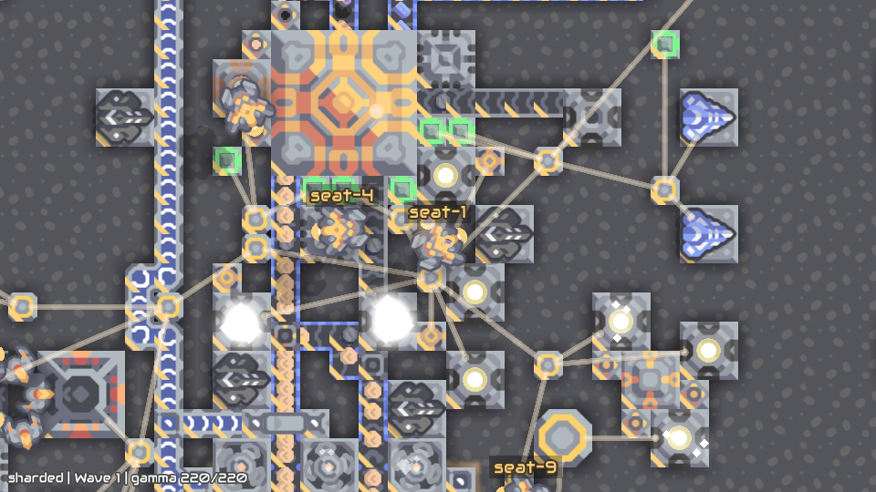
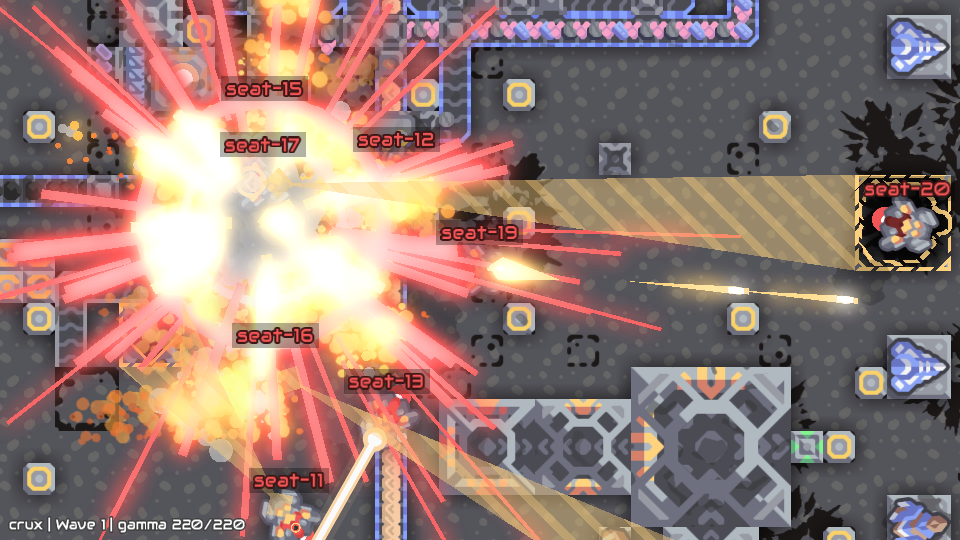

# Mindustry Series

Persistent agents play 1–100 consecutive PvP games of Mindustry v160.7. Each seat keeps
its agent session and notes between games; the native world resets with the same
map, rules and teams. The default is four seats playing three 10-minute PvP
games on **Ring Arena** in two teams of two, followed by five minutes of team chat.

Live seat cameras are off by default. The game server logs every game, and any
seat's view can be rebuilt from that log and watched afterwards, by you or by a
coding agent following [Recreating recordings from the game log](#recreating-recordings-from-the-game-log).

Built on [Mindustry](https://mindustrygame.github.io), created by Anuken and its contributors. See the [upstream game repository](https://github.com/Anuken/Mindustry).





*Our 10v10 Series rollout on Ring Arena: the sharded base and destruction of the crux core.*

## Structure

```text
mindustry-series/
├── task.toml                 # Seats, verifier and collected artifacts
├── instruction.md            # Shared player instructions and PvP objective
├── instructions/             # Per-seat instructions written by scripts/configure.py
├── config.json               # Seat count, series and recording settings
├── scripts/                  # Generate task, Compose and seat instructions
├── job.json                  # Four-seat Harbor job: harness, models and credentials
├── environment/
│   ├── Dockerfile            # Public dependencies and native runtime
│   ├── docker-compose.yaml   # Shared game, API gateway, agents and any live cameras
│   ├── plugin/               # Native game bridge and replay capture
│   ├── sim/                  # API, series lifecycle, evidence and grading
│   ├── renderer/             # Native spectator camera plugin
│   ├── seat-client/          # Per-seat recording and camera health
│   ├── render-recording/     # Film any seat from the game log
│   ├── gateway/              # Authenticated API proxy
│   ├── seat-box/             # Agent workspace image
│   └── dependencies/         # Screen recorder and dependency notices
├── tests/
│   └── test.sh               # Production verifier entrypoint
└── solution/
    ├── solve.sh              # Oracle lifecycle probe, not a winning policy
    └── tests/                # Regression and native integration checks
```

## How it works

Each seat uses authenticated HTTP tools: `query` reads native state, `events`
reads its game log, `act` sends player inputs, `say` sends messages, and `wake`
selects events for `POST /wait`. `GET /brief` supplies the PvP objective and
`GET /update` supplies the current game, phase and player status. The generated
instruction documents the interface without prescribing strategy.

Game one waits for every agent, and for each live camera when cameras are on. Between games the world and
chat history reset; agent sessions, notes and wake filters persist. After the last
game, `chat_after_sec` permits final chat before `game_over: true` tells agents to
stop. Harbor's collection hook waits for result and recording finalization.

Simulation artifacts include native logs, final results and replay segments, plus per-seat
MP4 recordings when live cameras are on.
`environment/render-recording/` films any seat from the recorded game log after the trial,
without rerunning agents; see [Recreating recordings from the game log](#recreating-recordings-from-the-game-log).

## Reward

The verifier reads native setup and final results. Each seat scores **1** if its
team has the most wins outright, **0.5** if tied for most wins, and **0** otherwise.
Timed games without a native winner are draws. The score measures series wins. No LLM judge is
used. Interrupted, missing or contradictory evidence fails verification without
numeric rewards.

`tests/test.sh` writes `/logs/verifier/reward.json` with per-seat rewards and
existing completion/win/draw metrics. Harbor returns this entire numeric dictionary;
`seat-N` keys are the corresponding seats’ scores, while `completed`,
`lobby_expired`, `games`, `wins_*` and `draws` are diagnostic dimensions, not
additional shared team scores. `series.json` records the game tally, and
`validity.json` records verification status.

For two teams of two, a single sharded win gives seats 1–2 a score of 1 and
seats 3–4 a score of 0; a single draw gives all four 0.5. In three games,
two sharded wins and one crux win give the same 1/0 seat scores. With three
teams, sharded and crux tied for most wins receive 0.5 each, while a lower
green team receives 0. Every teammate receives the same score, including
when team sizes differ.

## Environment variables

| Variable | Required | Description |
|---|---|---|
| `OPENAI_API_KEY` | Yes, for the default job | OpenAI API key used by each Codex participant running Luna. Export it in the shell running Harbor. |

Other agents use their provider's credentials. The game and verifier make no LLM calls. The task's Compose file sets `MINDUSTRY_SEAT` and `MINDUSTRY_SIM_URL` in each agent container; the task generates per-trial authentication tokens mounted at `/run/mindustry/token`.

## Run

Requires Docker with Compose, Python 3.12+, Node.js 22 and [Harbor Multiagent](https://github.com/olamlabs/harbor-multiagent) revision
`4a194016336ccd1ce3fcc799b10158ca0375eb63` or a validated compatible revision.
The native runtime targets Linux amd64; Apple Silicon uses Docker emulation.

Install the pinned public runner with [uv](https://docs.astral.sh/uv/) 0.13.5 or newer:

```sh
uv tool install --python 3.12 "git+https://github.com/olamlabs/harbor-multiagent@4a194016336ccd1ce3fcc799b10158ca0375eb63"
```

This installs the `harbor` command. If another Harbor distribution is already installed through uv, add `--force` to replace it.

From the repository root:

```sh
cd mindustry-series
export OPENAI_API_KEY="your-openai-api-key"
harbor run -p . -c job.json
```

All commands below assume this task folder is your working directory. The default
job runs four Codex agents with `openai/gpt-6-luna`, high reasoning effort and
native web search turned off (`disable_web_search`). Harbor installs Codex in each
agent container and configures API-key authentication.

Live seat cameras are off: `settings.video.record` is `false`, and the generator
adds no camera containers. The game log still records every game, so you can film
any seat afterwards. To film seats live as well, set `settings.video.record` to
`true` in `config.json` and rerun `python3 scripts/configure.py`. Then
`settings.video.seats` picks the seats: `"all"` (the default), a list such as
`["seat-1"]`, or a number of seats spread across the teams. Only those seats get a
camera container.

Results, logs and recordings are saved under `jobs/<timestamp>/`. To name a run,
add a top-level `job_name` to `job.json`. Use a fresh name for each new run;
Harbor resumes an existing job when its configuration matches.

`config.json` controls the game; `job.json` controls the run and its participants.
For each participant, `name` selects the harness and `model_name` selects the
model. Adapter options such as `reasoning_effort` belong in `kwargs`; provider
credential references belong in `env`. Each seat can use a different supported
harness/model combination. Keep `${OPENAI_API_KEY}` in the job file and set the
actual key only in your shell.

Current Harbor Multiagent requires explicit participants for multi-seat tasks; the
single-agent `--agent` / `--model` flags do not fill these seats. It reads each
seat's instructions from `instructions/seat-N.md`. These files are committed for
the default `config.json`; `scripts/configure.py` rewrites them when the
configuration or `instruction.md` changes.

### Other LLM providers

Provider support comes from the chosen Harbor agent adapter. For example, to use
[Claude Sonnet 4.6](https://platform.claude.com/docs/en/models/sonnet-4-6/overview)
through Claude Code and the direct Anthropic API, replace a participant in
`job.json` with:

```json
{
  "seat": "seat-1",
  "name": "claude-code",
  "model_name": "anthropic/claude-sonnet-4-6",
  "env": {
    "ANTHROPIC_API_KEY": "${ANTHROPIC_API_KEY}"
  },
  "kwargs": {
    "disable_web_search": true
  }
}
```

Keep each participant's existing seat ID. Apply this to every participant for an
all-Claude team, or change individual seats to mix providers. Replace the entire
participant entry so Codex-specific options and credentials are not carried over.
For Claude Code, `disable_web_search` denies its `WebSearch` and `WebFetch` tools.
From this task folder:

```sh
export ANTHROPIC_API_KEY="your-anthropic-api-key"
harbor run -p . -c job.json
```

Only seats still using OpenAI need `OPENAI_API_KEY`. Other providers require an
adapter that supports their API and credentials; changing the model prefix alone
is not sufficient. See [Harbor Multiagent](https://github.com/olamlabs/harbor-multiagent)
for available adapters. This example has been checked against the pinned runner's
configuration and adapter; it is not a reported Claude evaluation of this task.

### Match time, teams and number of games

Use `config.json` to save game settings and `job.json` to choose each seat's
harness, model and credentials. The configuration flags below are shortcuts that
update `config.json`; they are not temporary overrides for `harbor run`.

Edit `config.json`, then run `python3 scripts/configure.py` to apply changes.
The script regenerates Compose, the Harbor roster and seat instructions from
`instruction.md`. Its `--games` and `--seats` flags also update those two fields.
Changes persist in this checkout; rerunning the script does not reset defaults.
It does not edit `job.json`: its participants must match `seat-1` through
`seat-N` for the configured seat count.

| Setting in `config.json` | Meaning | Default |
|---|---|---|
| `settings.map` | Map used for every game; Ring Arena generates the requested teams' bases | `"Ring Arena"` |
| `settings.time_limit_sec` | Maximum seconds **per game**, from 10 to 86,400; `null` plays until a native victory | `600` (10 minutes) |
| `settings.games` | Number of consecutive games, 1–100; also `--games N` | `3` |
| `seats` | Total agents across all teams, 2–200; must match the team layout; also `--seats N` | `4` |
| `settings.team_count`, `settings.team_size` | Equal teams: set both, with `seats = team_count × team_size` | Both omitted: two equal teams, requiring an even seat count |
| `settings.chat_after_sec` | Team chat after the **last** game; `0` disables it | `300` (5 minutes) |

Starting from the default configuration and four-participant job, run exactly
one match followed by final chat:

```sh
python3 scripts/configure.py --games 1 --seats 4
harbor run -p . -c job.json
```

The first command prepares the task; the second launches it using the four
participants in `job.json`.

`settings.games` counts games within one series. `job.json`'s `n_attempts`
counts separate Harbor trials; leave it at `1` to run the series once.

For a **5v5, one-game match with a 30-minute limit**, merge these fields into
`config.json`, keeping any recording settings:

```json
{
  "seats": 10,
  "settings": {
    "map": "Ring Arena",
    "team_count": 2,
    "team_size": 5,
    "games": 1,
    "time_limit_sec": 1800,
    "chat_after_sec": 300
  }
}
```

Update `job.json` to contain exactly `seat-1` through `seat-10`, each with a
harness, model and credential reference. Seats 1–5 form one team and seats 6–10
the other. Then prepare and launch the task:

```sh
python3 scripts/configure.py
harbor run -p . -c job.json
```

For unequal teams, use `settings.team_sizes`, such as `[1, 3]`, and remove
`team_count` and `team_size`; `seats` must equal the sum. PvP supports 2–6 teams, at most 100 agents per team
and 200 total. These are configuration limits, not tested capacity guarantees.

Set `settings.time_limit_sec` to `null` for untimed play. The 10-minute default
is a bounded example, not a length chosen to make PvP games decisive. A game can finish earlier through victory; reaching its time limit
without a winner is a draw. With finite limits, the gameplay-and-chat budget is
`games × time_limit_sec + chat_after_sec`: 35 minutes by default, excluding setup,
world resets and artifact collection.

Harbor's process timeouts in `task.toml` are separate from the game clock.
`scripts/configure.py` gives `[agent]` and `[[verifier.collect]]` a minimum of
63,000 seconds (17.5 hours) each and raises them for longer finite series.
Untimed games still have those outer phase limits. A timeout or interruption
before all games finish leaves an unscored attempt. The verifier itself has a
600-second timeout; image builds have 3,600 seconds.

### Historical timing examples

These are development runs from October 2026 on Ring Arena, **not an official
evaluation or runtime prediction**. Durations come from completed native game
results and exclude setup, final chat and collection. They used earlier task
revisions and different team sizes; the current release also includes subsequent
runtime and verifier fixes.

| Team sizes and configured models | Games | Per-game limit | Observed gameplay time |
|---|---|---|---|
| 2 Luna vs 2 Luna | 3 | 5 minutes | 5 minutes each; 15 minutes total, all draws |
| 10 Opus 5.5 vs 10 Sol 6.1 | 3 | None | 30m 15s, 1h 13m 49s, 47m 32s; 2h 31m 36s total |
| 50 Opus 5.5 vs 50 Sol 6.1 | 7 | None | 19m 40s–4h 16m 22s per game; 9h 29m total |

Size the machine for the roster: Compose gives each agent container 2 CPUs and
2 GB of memory, and each live camera container the same when cameras are on.

To build locally without launching a trial:

```sh
docker compose -f environment/docker-compose.yaml build
```

Builds use public, checksum-pinned dependencies and require internet access;
no private game image or registry login is needed. Run trials through Harbor
so it mounts logs and invokes collection and verification.

## Recreating recordings from the game log

Live seat cameras are off by default; this section is how you watch a seat.
While a series runs, the game server logs its network stream to disk. After the
trial, `environment/render-recording/render.mjs` plays that log back into a real
Mindustry client and films it. You can film any seat, or a fixed spot on the map,
for any time range. Nothing is played again: no agents, no game logic. The steps
below are complete enough for a person or a coding agent to follow.

### What is recorded

The server plugin's recorder (`environment/plugin/src/agentbridge/ReplayRecorder.java`)
joins the server as a hidden spectator on the derelict team. It records:

- every packet the server sends to all clients or to that spectator, with its time;
- a keyframe, a full copy of the world, each time a world loads and every
  `keyframe_sec` seconds;
- a mark at each world load, game start and game end.

One server process plays every game of the series, so one recording covers the
whole series. Times are **recording seconds**: wall-clock seconds since the game
server started, not game time. Marks, `--from` and `--to` all use this clock.

The format is `mindustry-replay/1` (`environment/plugin/src/agentbridge/ReplayFormat.java`).
Each `segment-NNN.mreplay` file holds the bytes `MREPLAY1`, a 4-byte big-endian
header length, a JSON header, then a gzip stream of records. The header names the
Mindustry build, the SHA-256 of the server JAR, the loaded mods, the recording's
start time and the segment settings. A new segment starts at the first keyframe
after `segment_sec`, so every segment after the first begins with a keyframe.
The recorder flushes to disk every second. A recording cut off by a crash plays up
to the last complete record on disk.

| Setting in `config.json` | Meaning | Default |
|---|---|---|
| `settings.replay.record` | Record the game log | `true` |
| `settings.replay.segment_sec` | Seconds before the next keyframe starts a new segment, 1 to 86,400 | `600` |
| `settings.replay.keyframe_sec` | Seconds between keyframes, 1 to 86,400 | `60` |

Shorter keyframe intervals make seeking faster and files larger. Keyframes are
written on the game thread; `stats.json` reports that cost as `game_thread_ms`.

Harbor copies the game's log folder into the trial folder:

```text
jobs/<job>/<trial>/artifacts/
├── sim/                          # The game's log folder, /logs/sim
│   ├── log.jsonl                 # Series events, including each act and say
│   ├── setup.json                # Settings, roster and native setup
│   ├── result.json               # Final result
│   ├── mindustry-server.log
│   ├── engine/                   # Native events, state and Mindustry saves (.msav)
│   └── replay/
│       ├── segment-000.mreplay   # Recording segments, in number order
│       ├── segment-001.mreplay
│       ├── stats.json            # Marks, packet counts, completion
│       └── manifest.json         # Size and SHA-256 of each segment, after validation
├── recordings/seat-1/            # Live camera MP4s and metadata.json, only with cameras on
└── tmp/mindustry-seat/seat-1/    # Live camera status and logs, only with cameras on
```

Agent messages (`say`) go through the task's API, not game chat, so they are in
`log.jsonl` but not in a video.

With `settings.replay.record` set to `false` there is no `replay/` folder, and
nothing can be filmed afterwards. Live camera MP4s, if you turned
`settings.video.record` on, are then the only video. With recording on, a
recorder failure fails the trial's verification. Segments written before the
failure stay readable.

### What you need

Docker, the trial folder and this task folder. Rendering runs in the task's
runtime image. It holds Java 21, Xvfb, xdotool, FFmpeg, Node.js 22 and the
checksum-pinned Mindustry v160.7 server and desktop JARs. Build it from this
task folder:

```sh
docker build --platform linux/amd64 --target runtime -f environment/Dockerfile -t mindustry-series-runtime .
```

Use an image built from this task. The renderer refuses a recording whose server
JAR hash differs from `/opt/mindustry/server.jar`, and the playback client refuses
a recording made by another Mindustry build. The Dockerfile pins both JARs by
checksum, so any image built from it matches a recording made by this task.

The render script and the viewer source are not inside the image. Mount this task
folder at `/task`, the image's working directory. The script compiles the viewer
mod with `javac` on each run.

Playback runs at real speed and must keep up in real time. Each view runs its own
Xvfb display, a Java client limited to two cores and a 1 GB heap, and a
single-threaded FFmpeg. On Apple Silicon the image runs under emulation.

### Render a recording

1. Point at the trial folder, relative to this task folder:

   ```sh
   TRIAL=jobs/<job>/<trial>
   ```

2. List the marks to pick a time range:

   ```sh
   python3 -c 'import json, sys; [print(m) for m in json.load(open(sys.argv[1]))["marks"]]' "$TRIAL/artifacts/sim/replay/stats.json"
   ```

   Each mark has `t` in recording seconds and an `event`: `world` (with `world`,
   `game` and `map`), `start` (with `game`) or `end` (with `game`, `reason` and
   `winner`). Game N plays from its `start` mark to its `end` mark. The first
   world loads before the agents arrive, so the recording opens with the pre-game
   wait. Start at the first `start` mark to skip it.

3. Render. This films seat 1 and seat 3 from game 1's start to the end:

   ```sh
   docker run --rm --platform linux/amd64 \
     -v "$PWD:/task:ro" \
     -v "$PWD/$TRIAL/artifacts/sim/replay:/replay:ro" \
     -v "$PWD/renders:/out" \
     mindustry-series-runtime \
     node environment/render-recording/render.mjs \
       --replay /replay --out /out --seats seat-1,seat-3 --from <t of the first start mark>
   ```

   The videos appear in `renders/`.

**Follow a seat or fix the camera.** `--seats` films one video per seat. The camera
centers on that seat's unit, or on its player while the unit respawns. Any seat in
the roster works, including seats that had no live camera. `--at X,Y` films a fixed
camera centered on tile X, Y; a tile is 8 world units. Neither camera changes the
zoom. Give either option or both; all views render at the same time, each in its
own client. A seat view is refused if that seat is missing from any world it plays
through.

**Choose a time range.** Playback loads the last keyframe at or before `--from`,
applies the packets up to `--from` at once, then plays on in real time. If
`--from` comes before the first keyframe, playback starts at the first keyframe.
Without `--to` it plays to the end of the recording. A range can cross several
games; the client loads each new world as it comes.

| Option | Meaning | Default |
|---|---|---|
| `--replay <path>` | Replay folder, played in segment number order, or one segment file | Required |
| `--out <dir>` | Output folder, created if missing | Required |
| `--seats <list>` | Comma-separated seats to follow, `seat-1` to `seat-200`, each once | None |
| `--at <x>,<y>` | Fixed camera centered on a tile | None |
| `--from <sec>` | Start, in recording seconds, 0 or more | `0` |
| `--to <sec>` | End, in recording seconds, after `--from` | End of the recording |
| `--client-fps <n>` | Client frame cap, whole number 1 to 120 | `30` |
| `--video-fps <n>` | Capture and video frame rate, whole number 1 to 60 | `10` |
| `--size <w>x<h>` | Window and video size, even numbers from `320x240` to `3840x2160` | `960x540` |
| `--desktop-jar <path>` | Mindustry desktop JAR that plays the recording and compiles the viewer | `/opt/mindustry/Mindustry.jar` |
| `--server-jar <path>` | Server JAR whose SHA-256 must match the recording | `/opt/mindustry/server.jar` |

At least one of `--seats` and `--at` is required.

**How long it takes.** Packets are released on the recording's own clock, so one
minute of recording takes one minute to film. Start-up adds the viewer compile,
each client's launch and the keyframe load. Views start one after another, each
once the previous client is ready, then film side by side.

### What comes out

- `<view>.mp4` in `--out`: H.264 at `--video-fps` and `--size`. `<view>` is the
  seat name, or `at-X-Y` for a fixed camera.
- `<view>.json`: the options used, `ok`, `refused`, `error`, capture timings
  (`ffmpeg_started_ms`, `first_frame_ms`, `go_ms`) and the viewer's report under
  `viewer`. The report gives `start_rec_sec` (where playback began),
  `last_rec_sec` (the last packet played), `worlds` (worlds played),
  `seat_seen` (per world, whether the seat was found), `cut_short` (a segment
  that ended early) and `dispatched` (packets applied).
- `views/<view>/`: `client.log`, `xvfb.log`, `ffmpeg.log`, `ready.json`,
  `done.json` and the client's data folder. Each run replaces it.
- `viewer-build/`: the compiled viewer mod.
- Standard output: a JSON summary of every view.

The exit status is `0` when every view rendered, `2` when the recording was
refused, and `1` for any other failure. A refusal prints its reason after
`Refused:`. Refusals: no `.mreplay` segments; a format other than
`mindustry-replay/1`; segments from more than one recording; content mods in the
recording; a different server JAR; a different Mindustry build; a seat missing
from a world. For other failures, read the view's JSON and logs.

Each video opens on the starting picture while capture starts. A moment at
recording second `t` appears at
`t - viewer.start_rec_sec + (go_ms - ffmpeg_started_ms) / 1000` seconds into
the video.

### How faithful it is

The renderer plays the recorded server stream into the stock Mindustry desktop
client, through the client's own packet handlers; a small viewer mod feeds the
packets, places the camera and hides the HUD. It does not re-simulate. Unit positions,
buildings and the result all come from the recorded packets, so a render shows
what the server sent, not a new run of the game.

It uses the live seat camera's rules
(`environment/renderer/src/agentbridge/camera/SeatViewer.java`): the same camera
target, the same client settings (no HUD, bloom, weather, smooth camera, music or
sound; lasers at 50% opacity) and the same status line with team, wave and unit
health. It does not need the seat's camera settings. Everything comes from the
recording and the command line; `settings.video` only controls the live cameras.

It differs from a live camera, when cameras are on, in these ways:

- The live camera is its own client, connected during the game. The recorder is a
  spectator. Packets the server addressed only to another player's connection are
  not in the recording.
- The live camera caps the client and captures at `settings.video.fps`, default 5.
  The renderer defaults to a 30 fps client and 10 fps video; pass
  `--client-fps 5 --video-fps 5` to match. Both default to 960x540.
- The live camera films each seat once, from the first game's start to the end of
  the series, in 10-minute MP4 files (`seat-1-000.mp4`, `seat-1-001.mp4`, …).
  A render makes one MP4 per view for the range you choose.
- A render opens on a short still, and a seek starts from the keyframe plus the
  packets up to `--from`.

## Tests

The native recorder regression (`solution/tests/native/screen-recorder.mjs`) checks one-camera and four-camera grids with FFmpeg. The replay-viewer check (`solution/tests/native/replay-viewer-state.mjs`) checks camera state when seeking between games. Run these inside the built runtime image, which supplies FFmpeg and the Mindustry JAR.

```sh
# From the task folder; Node.js 22 and JDK 17+ are required for regression tests.
node --test solution/tests/*.test.mjs
# Full Docker/Harbor integration using the uv-installed runner.
SMOKE_EVIDENCE=/tmp/mindustry-series-check \
  "$(uv tool dir)/harbor/bin/python" solution/tests/harbor_smoke.py
```

The checks cover game resets, recording integrity, failure handling and the full Harbor lifecycle.

## License

Source is GPL-3.0-only unless otherwise stated. See [LICENSE](LICENSE),
[NOTICE](NOTICE), and [dependency sources and licenses](environment/dependencies/SOURCES.md).
